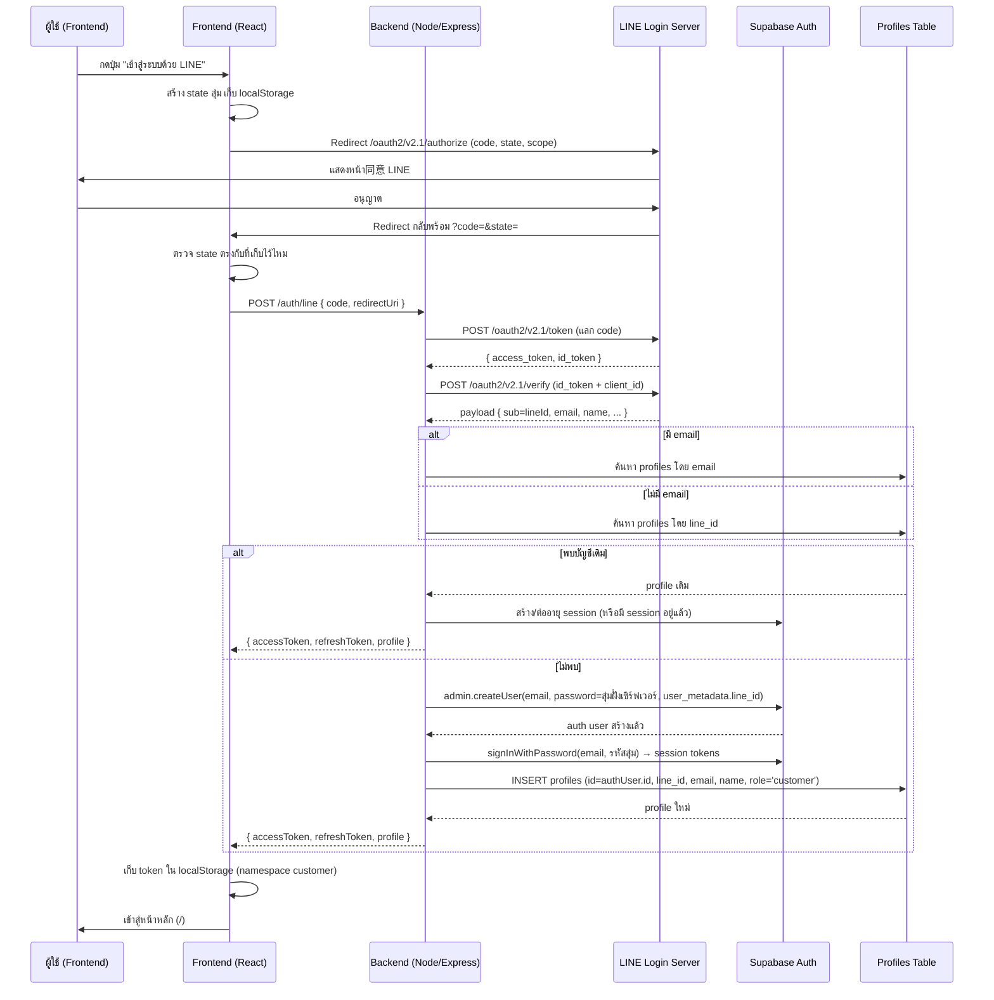
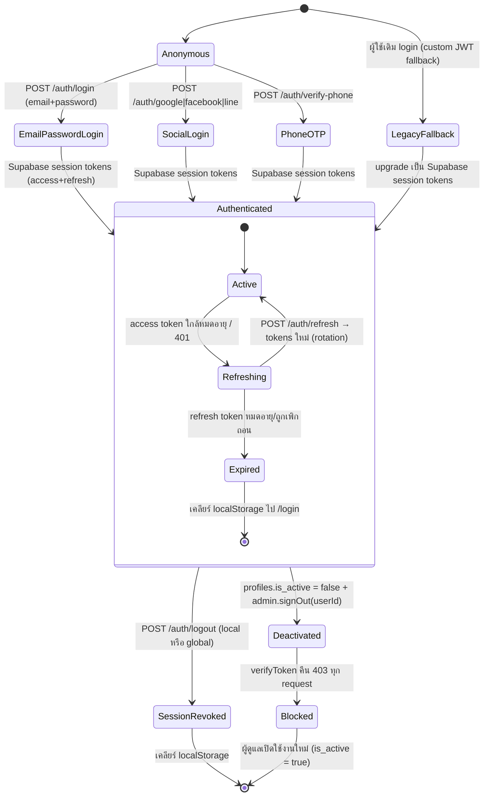

# Kindee Marketplace — Phase 1C: Authentication Architecture Decision & Implementation Blueprint

**สถานะ:** READ-ONLY / PLAN ONLY — ห้ามแก้ไข Source Code, ห้ามแก้ไข `.env`, ห้ามรัน SQL/Migration, ห้ามเขียนข้อมูลลง Supabase Production, ห้าม commit/push/deploy  
**วันที่:** 2026-11-16  
**อ้างอิง:** AUTH_AUDIT_REPORT.md (Phase 1B), AUTH_RECOVERY_PLAN.md, โค้ดจริงทั้ง backend (`backend/`) และ frontend (`frontend/src/`)

---

## 0. สรุปผู้บริหาร (Executive Summary)

ระบบปัจจุบันมี **สองระบบ Authentication ทำงานพร้อมกัน** ทำให้เกิดความขัดแย้งของ Token:
- **ระบบเก่า (MongoDB):** `jsonwebtoken` + `bcryptjs`, custom JWT (`generateToken`/`generateRefreshToken`/`verifyRefreshToken`) ใน `backend/middleware/auth.js` และ `backend/services/authService.js` — เส้นทางเก่าใน `backend/routes/auth.js` ยังมีอยู่แต่ไม่ถูก mount ใน `routes/index.js`
- **ระบบใหม่ (Supabase):** `supabase-js`, Supabase Auth (GoTrue), เส้นทางใหม่ใน `backend/routes/authRoutes.js` (mount ที่ `/api/auth`)

**คำแนะนำสรุป:** ยกเลิก Custom JWT ทั้งหมด ยกระดับ **Supabase Auth เป็น Session หลักเพียงระบบเดียว** รองรับ Email/Password, Google, Facebook, LINE ผม backend flow ที่ควบคุมโดยเซิร์ฟเวอร์ (ไม่ส่ง Random Password ให้ Frontend) พร้อมแผนย้าย Legacy User และแยก namespace ระหว่าง Customer / Admin Session ชัดเจน

---

## 1. Session Architecture

### 1.1 เปรียบเทียบ Token แต่ละชนิด

| ชนิด | ผู้ออก | อายุ | การเก็บ | การใช้งาน | สถานะในระบบปัจจุบัน |
|-----|--------|-----|---------|----------|----------------------|
| **Supabase access token** | Supabase Auth (GoTrue) | ~1 ชั่วโมง (default) | `localStorage` (`kindee:customer:token` / `kindee:admin:token`) | ส่งใน `Authorization: Bearer <token>` ทุก request API | ใช้ผ่าน `supabaseAuth.auth.getUser(token)` ใน middleware |
| **Supabase refresh token** | Supabase Auth | ~30 วัน (default, rotatable) | `localStorage` (`kindee:customer:refreshToken` / `kindee:admin:refreshToken`) | เรียก `/auth/refresh` หรือ `supabase.auth.refreshSession()` | **ไม่ถูกใช้จริง** — ปัจจุบัน refresh ด้วย custom JWT |
| **Legacy Kindee custom JWT** | Backend (`jsonwebtoken`, `JWT_SECRET`) | 7d / 30d | `localStorage` เดียวกัน | fallback verification ใน `middleware/auth.js:28-40` | **ยังคงใช้อยู่** — authService ออก token นี้ ไม่ใช่ Supabase session |
| **Admin/Customer token namespace** | Frontend (`localStorage` คีย์แยก) | ตาม token | `kindee:admin:*` vs `kindee:customer:*` | `AuthContext` แยก state customer/admin, `ProtectedRoute(mode=...)`, `RequireAdmin` | แยกที่ frontend เท่านั้น backend ไม่มี namespace |

### 1.2 ปัญหาที่พบจริง (ยืนยันจากโค้ด)

1. `backend/middleware/auth.js:25-41` — `verifyToken` ตรวจ Supabase JWT ก่อน ถ้าfail จะ **fallback ไป custom JWT** (`jwt.verify`) → สองระบบใช้ร่วมกันได้พร้อมกัน
2. `backend/services/authService.js:60-61, 108-109, 190-191` — `registerUser`/`loginUser`/`socialLogin` ออก **custom JWT** ไม่ใช่ Supabase session tokens
3. `backend/services/authService.js:287-310` — `refreshAccessToken` ใช้ custom `verifyRefreshToken` ไม่ใช่ Supabase refresh
4. `backend/services/authService.js:314-324` — `logoutUser` เรียก `supabase.auth.signOut()` แต่ token ที่แจกเป็น custom JWT → `signOut()` ไม่มีผลต่อ custom JWT ที่ออกไว้แล้ว
5. `backend/middleware/auth.js:204-228` — ฟังก์ชัน custom JWT ยังคงอยู่และถูก import โดย `authService.js:2`

### 1.3 สถาปัตยกรรม Session ที่แนะนำ (ระยะยาว — ระบบเดียว)

```
┌─────────────────────────────────────────────────────────────────┐
│                    Supabase Auth = Single Source of Truth        │
├─────────────────────────────────────────────────────────────────┤
│  Identity & Credentials : Supabase Auth (email, phone, OAuth)   │
│  Session Management     : Supabase (access_token + refresh_token)│
│  Profile Data           : public.profiles (1:1 กับ auth.users)   │
│  Authorization (RBAC)   : profiles.role + RLS + middleware       │
│  Token Verification     : supabaseAuth.auth.getUser(token) เท่านั้น│
└─────────────────────────────────────────────────────────────────┘
```

- **ลบ** `generateToken`, `generateRefreshToken`, `verifyRefreshToken`, `JWT_SECRET` ออกจาก `middleware/auth.js` และทุกการ import
- `verifyToken` ใช้ **เฉพาะ** `supabaseAuth.auth.getUser(token)` แล้วดึง `profiles.role` มาใส่ `req.user.role`
- Access token / Refresh token ที่ออกโดย Supabase เท่านั้นที่ถือว่าถูกต้อง
- Custom JWT ถูกยกเลิกหลังช่วง transition (legacy users login ครั้งแรกจะถูกย้ายเป็นที่อธิบายใน §1.6)

### 1.4 แยก Customer / Admin Token Namespace

รักษาการแยกที่ frontend ด้วย `localStorage` คีย์สองชุด (มีอยู่แล้ว):
- `kindee:customer:token`, `kindee:customer:refreshToken`, `kindee:customer:user`
- `kindee:admin:token`, `kindee:admin:refreshToken`, `kindee:admin:user`

Backend `verifyToken` อ่าน role จาก `profiles.role` เท่านั้น ไม่เชื่อม `role` claim ใน Supabase JWT (Supabase ไม่มี claim `role` ตามการออกแบบเดิม) → Customer และ Admin Session **ไม่ปะปนกัน** เพราะแยกที่ localStorage namespace และตรวจ role จาก profiles ทุก request

### 1.5 แผนรองรับ Legacy User (MongoDB → Supabase)

ผู้ใช้เดิมใน MongoDB ที่มี `password_hash` (bcrypt cost 10) จะถูกย้ายเข้า Supabase ด้วยพารามิเตอร์ `password_hash` ของ `supabaseAdmin.auth.admin.createUser` (Supabase รองรับ bcrypt hash โดยตรง) — อ้างอิง AUTH_RECOVERY_PLAN.md §6.2

**ช่วง transition (fallback login):**
1. ลูกค้าเดิม login → Supabase `signInWithPassword` อาจยังไม่มี user → backend ตรวจ MongoDB (bcrypt compare) เป็นขั้นตอนสำรอง
2. ถ้า match → backend สร้าง Supabase user ด้วย `password_hash` เดิม แล้วคืน Supabase session tokens
3. หลังย้ายครบ → ลบโค้ด fallback และลบ MongoDB `users` collection

ผู้ใช้เดิมไม่ต้อง_reset_password_ และไม่ต้องสมัครใหม่

### 1.6 คำตอบเกณฑ์การตัดสินใจ: LINE User จะได้รับ Supabase Session จริงด้วยวิธีใด

LINE **ไม่ใช่** provider ที่ Supabase รองรับในตัว และ LINE Web Login ลงชื่อด้วย **HS256 (channel secret)** ไม่ใช่ ES256/JWKS → Supabase Custom OIDC Provider (ซึ่งอิง JWKS) **ใช้ไม่ได้** สำหรับ LINE web login ตามเอกสาร LINE ที่ยืนยันแล้ว (§3)

**วิธีที่ใช้จริง (backend-verified code exchange):**

```
1. Frontend redirect ไป https://access.line.me/oauth2/v2.1/authorize (มีอยู่แล้วใน Login.jsx/Register.jsx)
2. LINE redirect กลับมาที่ frontend พร้อม ?code=...&state=...
3. Frontend ส่ง { code, redirectUri } ไป POST /auth/line (backend)
4. Backend แลก code ที่ https://api.line.me/oauth2/v2.1/token (grant_type=authorization_code, client_id, client_secret, redirect_uri)
   → ได้ { access_token, id_token, ... }
5. Backend verify ID token ที่ https://api.line.me/oauth2/v2.1/verify (POST id_token + client_id)
   → payload { sub=lineId, name, picture, email, email_verified, iss, aud, exp }
   validate iss=https://access.line.me, aud=channelId, exp
6. ถ้าไม่มี id_token → เรียก https://api.line.me/v2/profile (Bearer access_token) → userId, displayName, pictureUrl
7. Backend ค้นหา user เดิมใน profiles โดย line_id (หรือ email ถ้ามี)
8. ถ้าไม่มี → สร้าง Supabase auth user:
   supabaseAdmin.auth.admin.createUser({
     email: email ?? placeholderEmail(lineId),
     password: <random-secure-password-generated-server-side>,
     email_confirm: email ? email_verified : true,
     user_metadata: { line_id, name, avatar_url, provider: 'line' }
   })
   **รหัสผ่านสุ่มนี้สร้างและใช้เฉพาะฝั่งเซิร์ฟเวอร์ ไม่ส่งให้ Frontend**
9. Backend เรียก supabase.auth.signInWithPassword({ email, password: randomPassword })
   → ได้ Supabase session { access_token, refresh_token }
10. Backend upsert profiles (id = authUser.id, email, phone, name, avatar_url, role='customer', line_id, is_active)
11. Backend คืน { user: profile, accessToken, refreshToken } ให้ Frontend
12. Frontend เก็บใน localStorage namespace customer (เหมือน login ปกติ)
```

**ข้อสังเกตสำคัญ:** ขั้นตอน 8–9 คือการสร้าง Supabase session จริงโดยไม่ต้องส่ง random password ให้ Frontend (รหัสผ่านถูกใช้แค่ภายในเซิร์ฟเวอร์เพื่อแลก session กับ Supabase แล้วทิ้ง) — ตรงกับเงื่อนไข "ห้ามส่ง Random Password ให้ Frontend"

วิธีนี้ต้องทำ PoC ยืนยันว่า `signInWithPassword` จาก backend ผ่าน anon key คืน session tokens ได้ตามที่คาด และว่า placeholder email ไม่ชนกับ constraint UNIQUE

---

## 2. LINE Login

### 2.1 เอกสารและ API ของ LINE (ยืนยันแล้วจาก AUTH_RECOVERY_PLAN.md §4)

| รายการ | ค่า | ที่มา | สถานะ |
|--------|-----|------|--------|
| LINE issuer | `https://access.line.me` | LINE Login docs (verify-id-token) | ✅ ยืนยันแล้ว |
| OpenID Discovery | `https://access.line.me/.well-known/openid-configuration` | LINE Login docs | ✅ ยืนยันแล้ว |
| Token endpoint | `https://api.line.me/oauth2/v2.1/token` | LINE Login docs | ✅ ยืนยันแล้ว |
| JWKS URI | `https://api.line.me/oauth2/v2.1/certs` | LINE Login docs | ✅ ยืนยันแล้ว |
| Verify ID token endpoint | `POST https://api.line.me/oauth2/v2.1/verify` (id_token + client_id) | LINE Login docs | ✅ ยืนยันแล้ว |
| ช่องทางลงชื่อเว็บ (Web Login) | **HS256** (HMAC ด้วย channel secret) | LINE Login docs | ✅ ยืนยันแล้ว |
| ช่องทาง Native / LIFF | **ES256** (JWKS, kid header) | LINE Login docs | ✅ ยืนยันแล้ว |
| `id_token_signing_alg_values_supported` | `["ES256"]` เท่านั้น | LINE discovery doc | ✅ ยืนยันแล้ว |

**ข้อจำกัดสำคัญ (ยืนยันแล้ว):** Supabase Custom OIDC Provider อิง JWKS ตามเอกสาร Supabase custom-oauth-providers แต่ LINE web-login ID token ลงชื่อด้วย **HS256** ในขณะที่ discovery doc ของ LINE ประกาศรองรับแค่ ES256 → การตั้งค่า LINE เป็น Custom OIDC Provider บน Supabase **ใช้ไม่ได้จริง** สำหรับ web login ยกเว้นจะมี PoC ยืนยันเป็นอย่างอื่น Supabase PR #2578 (native LINE provider, ยังไม่ released) เพิ่มการ verify HS256 ด้วย channel secret ยืนยันว่าเป็นปัญหาที่ทราบและยังไม่แก้

**ข้อสรุป:** ใช้ custom server-side flow (แบบเดิมใน `authController.lineLogin()` lines 184-251) ไม่ใช้ Supabase native/custom OIDC สำหรับ LINE

### 2.2 LINE Authorization Code Flow (รายละเอียด)

```
Frontend                          LINE                        Backend
  |                                   |                            |
  |-- redirect /authorize ----------->|                            |
  |  response_type=code               |                            |
  |  client_id=channelId              |                            |
  |  redirect_uri=whitelisted         |                            |
  |  state=random (CSRF protection)   |                            |
  |  scope=profile openid email       |                            |
  |                                   |-- 로그인 / อนุญาต ------->|
  |                                   |                            |
  |<-- redirect with ?code&state -----|                            |
  |                                   |                            |
  |-- POST /auth/line {code} --------->|                            |
  |                                   |                            |
  |<-- {accessToken, refreshToken} ---|                            |
  |  + profile                        |                            |
```

### 2.3 State generation และ validation

- `state` ต้องสุ่มค่า (cryptographically random, เช่น `crypto.randomBytes(16).toString('hex')`) สร้างต่อแต่ละครั้งที่กดปุ่ม LINE
- เก็บ `state` ใน `localStorage` หรือ session storage ชั่วคราวก่อน redirect
- เมื่อ LINE redirect กลับมา พร้อม `?state=...` backend (หรือ frontend) ต้อง **เปรียบเทียบ** state ที่ได้กับ state ที่เก็บไว้ → ถ้าไม่ตรงหรือหายให้ยกเลิก (ป้องกัน CSRF / Mix-Up attack)
- ปัจจุบันใน `Login.jsx:151` ใช้ `state = "line_login"` (ค่าคงที่) → **ต้องแก้เป็น state สุ่ม + validate** ก่อน deploy จริง

### 2.4 Token exchange

```
POST https://api.line.me/oauth2/v2.1/token
Content-Type: application/x-www-form-urlencoded

grant_type=authorization_code
&code={authorization_code}
&redirect_uri={redirect_uri}
&client_id={channel_id}
&client_secret={channel_secret}
```

ตอบกลับ: `{ access_token, expires_in, id_token, refresh_token (ในบางกรณี), token_type }`

### 2.5 ID Token verification

```
POST https://api.line.me/oauth2/v2.1/verify
Content-Type: application/x-www-form-urlencoded

id_token={id_token}
&client_id={channel_id}
```

Payload ตัวอย่าง: `{ sub, name, picture, email, email_verified, iss, aud, exp, iat }`

**ต้อง validate:**
- `iss` = `https://access.line.me`
- `aud` = `channel_id` ของแชนแนล
- `exp` > เวลาปัจจุบัน
- ลายเซ็น (สำหรับ HS256: verify ด้วย channel secret ผ่าน endpoint `/verify` ของ LINE เองแล้ว — endpoint นี้จัดการลายเซ็นให้แล้ว backend แค่เช็ค `iss`/`aud`/`exp`)

### 2.6 Access Token validation (กรณีไม่มี id_token)

ถ้า LINE คืนเฉพาะ `access_token` (ไม่มี `id_token`) ให้เรียก:
```
GET https://api.line.me/v2/profile
Authorization: Bearer {access_token}
```
ได้ `{ userId, displayName, pictureUrl, statusMessage }` (ไม่มี email)

### 2.7 LINE User ID

- `sub` ใน ID token payload = LINE User ID (รหัสตัวแทนผู้ใช้ของแชนแนลนั้น ๆ)
- เก็บใน `profiles.line_id` (TEXT, UNIQUE, nullable) + `user_metadata.line_id`
- **ไม่ควรใช้ `access_token` โดยตรงเป็นตัวตนผู้ใช้** ต้องผ่าน `sub` / `userId`

### 2.8 Email scope และกรณีไม่มี Email

- ขอ scope `profile openid email` แต่ LINE อาจ **ไม่คืน email** ถ้าผู้ใช้ยังไม่ยืนยันอีเมลกับ LINE หรือไม่ได้ให้สิทธิ์
- `email_verified` ใน payload บอกว่าอีเมลที่ LINE มีถูกยืนยันแล้วหรือไม่
- **กรณีไม่มี email:** อนุญาตให้สมัครได้ โดยใช้ placeholder email (`line-{lineId}@kindee.local`) ชั่วคราว แล้วให้ผู้ใช้ยืนยันอีเมลจริงภายหลัง (หรือใช้เบอร์โทร) — รายละเอียดใน §3

### 2.9 Redirect URI whitelist

- Redirect URI ที่ frontend ใช้ (`window.location.origin + "/login"` หรือ `"/register"` ตามที่เป็นอยู่) ต้องถูกเพิ่มใน **LINE Developers Console → ช่องทางของฉัน → การตั้งค่า URL → Callback URL**
- ใน production ต้องเป็น HTTPS และตรงกับ domain จริง (localhost ใช้ได้เฉพาะพัฒนา)
- ห้ามให้ redirect URI เป็นค่าที่ผู้ใช้ป้อนได้ (ต้อง hardcode หรือ validate whitelist ใน backend) ป้องกัน open redirect

### 2.10 วิธีทดสอบได้จริง (PoC)

1. สร้าง LINE Login Channel ใน LINE Developers Console เฉพาะ staging (ไม่ใช้ production credential)
2. กำหนด Callback URL = `https://staging.kindee.example.com/login` (และ `/register`)
3. ทำ end-to-end: กดปุ่ม LINE → LINE ล็อกอิน → redirect กลับพร้อม code → backend แลก code → verify ID token → สร้าง Supabase user → คืน session tokens → frontend เก็บ localStorage → เรียก API ที่มี token ได้
4. ทดสอบกรณี: มี email / ไม่มี email / login ซ้ำ / email ซ้ำกับบัญชีเดิม
5. **ห้ามสรุปข้อจำกัด HS256/JWKS โดยไม่มีหลักฐาน** — ต้องมี PoC หรืออ้างอิงเอกสาร LINE/Supabase ที่อ่านแล้วเท่านั้น (ปัจจุบันยืนยันจากเอกสารแล้วว่าไม่รองรับผ่าน Custom OIDC)

---

## 3. Identity & Account Linking

### 3.1 สถานการณ์ที่ต้องรองรับ

| สถานการณ์ | การจัดการ |
|-----------|-----------|
| LINE User มี Email | ถ้า email ยังไม่มีในระบบ → สร้างบัญชีใหม่ (email ถือว่ายืนยันแล้วจาก LINE `email_verified`) ถ้ามีอยู่แล้วกับบัญชีอื่น → **409** ให้ login ด้วย email ก่อนแล้วค่อย link |
| LINE User ไม่มี Email | ใช้ placeholder `line-{lineId}@kindee.local` + profiles.phone ว่าง → สร้างบัญชี → ให้ยืนยันอีเมล/เบอร์ภายหลัง ก่อนทำธุรกรรมสำคัญ |
| LINE User กลับมา Login ซ้ำ | ค้นหาโดย `profiles.line_id` → พบแล้วคืน session เดิม (idempotent) |
| Email ซ้ำกับบัญชีเดิม | ห้าม auto-link → คืน 409 "อีเมลนี้สมัครไว้แล้ว กรุณาเข้าสู่ระบบแล้วเชื่อมบัญชีในการตั้งค่า" |
| Google/Facebook/LINE ต้องการเชื่อมกับบัญชีเดียวกัน | ใช้ endpoint `POST /auth/link-account` หลังยืนยันตัวตนเจ้าของบัญชีเดิม (OTP/email/รหัสผ่าน) แล้วเรียก `supabase.auth.linkIdentity()` (สำหรับ provider ที่ Supabase รองรับ) หรือเก็บ provider_id ใน `user_metadata` + `profiles.{provider}_id` (สำหรับ LINE custom) |
| ป้องกัน Account Takeover | ไม่ auto-link โดยใช้ email เพียงอย่างเดียว ต้องยืนยัน owner ของบัญชีเดิมก่อน (รหัสผ่าน / OTP ที่ส่งไปยัง email/เบอร์เดิม) ตรวจ `email_verified` ของ provider |
| ป้องกัน Duplicate Account | Unique constraint บน `profiles.email` และ `profiles.phone` + `profiles.line_id` + ตรวจ identities ก่อนสร้าง user ใหม่ |

### 3.2 Placeholder Email vs profiles.email เป็น NULL

| แง่เปรียบเทียบ | Placeholder Email (`line-{id}@kindee.local` ฯลฯ) | profiles.email เป็น NULL (อนุญาต) |
|----------------|--------------------------------------------------|------------------------------------|
| ต้องเปลี่ยน migration | ไม่ (รักษา NOT NULL ไว้) | **ต้องมี migration** (`ALTER TABLE ... DROP NOT NULL`, ADD CHECK constraint) |
| ความถูกต้องเชิงความหมาย | ต่ำ — อีเมลปลอม ไม่ใช่อีเมลจริง | สูง — แยก "ไม่มีอีเมล" ออกจาก "มีอีเมล" |
| UNIQUE constraint | ใช้ได้ แต่ placeholder ต้องไม่ซ้ำกัน | NULL ซ้ำกันได้หลายแถว (PostgreSQL อนุญาต NULL หลายค่าใน UNIQUE) |
| Forgot/Reset Password | ใช้ไม่ได้กับ phone-only (อีเมลปลอม) | ใช้ได้เฉพาะบัญชีที่มี email จริง |
| Social login key | ใช้ placeholder เป็น email key ได้ | ต้องจัดการกรณี email null ใน social login |
| RLS / Queriesเดิม | ไม่กระทบ (email ยัง NOT NULL) | **กระทบทุกตำแหน่งที่อ้างอิง profiles.email** (ดูด้านล่าง) |
| Frontend | ต้องซ่อน placeholder email ไม่ให้ผู้ใช้เห็น | แสดงได้ตามจริง (อาจเป็น null) |
| Migration legacy users | ไม่ต้องเปลี่ยน schema | ต้องรัน migration ก่อนรับ phone-only |

**ผลกระทบต่อระบบเดิมทั้งหมด หากเปลี่ยน `profiles.email` เป็น NULL:**

1. `supabase/migrations/001_initial_schema.sql:29` — `email TEXT UNIQUE NOT NULL` ต้องแก้เป็น `TEXT UNIQUE` + เพิ่ม `CHECK (email IS NOT NULL OR phone IS NOT NULL)`
2. `backend/services/authService.js:40-49` — `registerUser` insert profile ใส่ `email` อาจเป็น null → ต้องยอมรับค่า null
3. `backend/services/authService.js:77-81` — `loginUser` ค้นหาโดย `or(email.eq, phone.eq)` → รองรับ email null ได้อยู่แล้ว (ค้นหาด้วย phone แทน)
4. `backend/services/authService.js:171` — `socialLogin` insert `email: authData.user.email` → อาจเป็น null → ต้องกรณีแบ่ง
5. `backend/routes/authRoutes.js:13-14` — validation register ยอมรับ email หรือ phone แยกกันอยู่แล้ว
6. `backend/middleware/auth.js:64-71` — `req.user.email` อาจเป็น null → frontend ต้องรองรับ
7. `frontend/src/api/auth.js` / `index.js` — login payload `{emailOrPhone, password}` → ไม่กระทบ
8. `frontend/src/pages/Register.jsx:88-91` — validation บังคับกรอก email → ต้องแก้ให้กรอก email หรือ phone อย่างใดอย่างหนึ่ง
9. `frontend/src/components/AuthContext.jsx` — `user.email` อาจ null → UI ต้องรองรับ
10. RLS policies (`002_rls_policies.sql`) — ใช้อ้างอิง `id = auth.uid()` เป็นหลัก ไม่ใช่ email → **ไม่กระทบ RLS โดยตรง**
11. Settings social-config — ไม่กระทบ
12. `005_create_admin_user.sql` — ค้นหา profile โดย email → ต้องมี email จริงสำหรับ owner → owner ต้องสมัครด้วย email จริง

**คำแนะนำ:** ใช้ **placeholder email เป็นทางเลือกชั่วคราว** เพื่อไม่บล็อกการพัฒนาโทรศัพท์-only และวางแผนย้ายเป็น `email NULLABLE + CHECK (email OR phone)` ในภายหลัง (หลังจากทดสอบบน staging แล้ว)

---

## 4. Supabase Profile Schema

### 4.1 Schema จริงจาก migration 001 (ยืนยันแล้ว)

```sql
CREATE TABLE profiles (
    id UUID PRIMARY KEY REFERENCES auth.users(id) ON DELETE CASCADE,
    email TEXT UNIQUE NOT NULL,          -- ← บล็อก phone-only
    phone TEXT UNIQUE,
    name TEXT,
    avatar_url TEXT,
    role user_role NOT NULL DEFAULT 'customer',  -- ENUM: customer, seller, admin, owner, courier
    is_active BOOLEAN DEFAULT true,
    legacy_id TEXT,                      -- สำหรับอ้างอิง MongoDB _id
    created_at TIMESTAMPTZ DEFAULT NOW(),
    updated_at TIMESTAMPTZ DEFAULT NOW()
);
```

- `auth.users` (จัดการโดย Supabase): `id` (UUID), `email`, `phone`, `encrypted_password`, `email_confirmed_at`, `phone_confirmed_at`, `user_metadata` (JSONB), `identities[]` (JSONB array), `raw_app_meta_data` (JSONB), `aud`, `created_at`, ...
- `profiles.id` = `auth.users.id` เสมอ (ON DELETE CASCADE)
- Indexes: `idx_profiles_email`, `idx_profiles_phone`, `idx_profiles_role`, `idx_profiles_legacy_id`
- RLS: เปิดใช้งานแล้วใน `002_rls_policies.sql` ฟังก์ชัน `get_current_user_role()` อ่าน `profiles.role` โดยใช้ `auth.uid()`

### 4.2 user_metadata และ provider identity mapping

- `auth.users.user_metadata`: เก็บ `name`, `avatar_url`, `role`, `legacy_id`, `{provider}_id` (เช่น `google_id`, `facebook_id`, `line_id`)
- `auth.users.identities[]`: Supabase เติมให้อัตโนมัติสำหรับ provider ในตัว (Google, Facebook หากใช้ native OAuth) รูปแบบ `{ provider, identity_data: { sub: ... }, id: uuid }`
- LINE (custom): Supabase **ไม่เติม identities[] ให้** → แอปต้องติดตาม `line_id` เองใน `profiles.line_id` + `user_metadata.line_id`

### 4.3 Schema เป้าหมาย (Target Schema)

ไม่เปลี่ยนโครงสร้างหลักของ `profiles` แต่เพิ่ม/ปรับดังนี้:

```sql
-- เปลี่ยน email ให้ nullable (หลังทดสอบ staging แล้วเท่านั้น)
ALTER TABLE profiles ALTER COLUMN email DROP NOT NULL;
ALTER TABLE profiles ADD CONSTRAINT profiles_email_or_phone_check
    CHECK (email IS NOT NULL OR phone IS NOT NULL);

-- เพิ่มคอลัมน์ provider mapping (app-owned, ไม่แตะ auth.* TABLES ภายในของ Supabase)
ALTER TABLE profiles ADD COLUMN IF NOT EXISTS google_id TEXT;
ALTER TABLE profiles ADD COLUMN IF NOT EXISTS facebook_id TEXT;
ALTER TABLE profiles ADD COLUMN IF NOT EXISTS line_id TEXT;
CREATE UNIQUE INDEX IF NOT EXISTS idx_profiles_google_id ON profiles(google_id) WHERE google_id IS NOT NULL;
CREATE UNIQUE INDEX IF NOT EXISTS idx_profiles_facebook_id ON profiles(facebook_id) WHERE facebook_id IS NOT NULL;
CREATE UNIQUE INDEX IF NOT EXISTS idx_profiles_line_id ON profiles(line_id) WHERE line_id IS NOT NULL;
```

หมายเหตุ: **ห้ามสร้าง index บน `auth.users.user_metadata->>'line_id'`** โดยตรง เพราะ `auth.*` เป็นตารางภายในของ Supabase ที่จัดการเอง (ยืนยันจาก AUTH_RECOVERY_PLAN.md §4.3)

### 4.4 Migration Plan (วางแผนเท่านั้น — ห้ามรันใน Phase 1C)

1. สร้างไฟล์ migration ใหม่ (เช่น `006_profiles_email_nullable_provider_ids.sql`) ตาม Target Schema ข้างต้น
2. ทดสอบบน **staging** Supabase project ก่อน production
3. ตรวจว่า `profiles.id = auth.users.id` ทุกแถวก่อนและหลัง migration
4. ตรวจ orphan records (FK ชี้ไป profiles ที่ไม่มีอยู่) ในทุกตารางที่อ้างอิง `profiles.id`
5. หลัง migration ยืนยันว่า email ซ้ำยังคงถูกบล็อกโดย UNIQUE constraint (ยกเว้น NULL)

---

## 5. Session Refresh & Logout

### 5.1 Refresh Token Rotation

Supabase จัดการ rotation ให้โดยอัตโนมัติเมื่อใช้ `supabase.auth.refreshSession()` — refresh token เก่าจะถูกเพิกถอน และคืน refresh token ใหม่

**Backend endpoint `POST /auth/refresh` (ปรับใหม่):**
```
Input: { refreshToken }
1. supabase.auth.refreshSession({ refresh_token: refreshToken })  (ผ่าน anon client หรือ supabaseAuth)
2. ได้ { access_token, refresh_token } ใหม่
3. คืน { accessToken, refreshToken } ให้ frontend เก็บแทนที่ตัวเก่า
4. ถ้า refresh token ไม่ถูกต้อง/หมดอายุ → 401 → frontend เคลียร์ session ทั้งหมด
```

### 5.2 Logout เครื่องปัจจุบัน (local)

Frontend: `supabase.auth.signOut({ scope: 'local' })` — เพิกถอนเฉพาะ session ปัจจุบัน (refresh token ที่ใช้อยู่)  
Backend option: `POST /auth/logout` รับ `{ revokeAllSessions: false }` → `supabase.auth.signOut({ scope: 'local' })`

### 5.3 Logout ทุกอุปกรณ์ (global)

Frontend: `supabase.auth.signOut()` (default scope = global) — เพิกถอนทุก session ที่ใช้ refresh token ชุดเดียวกัน  
Backend: `POST /auth/logout` รับ `{ revokeAllSessions: true }` (default) → `supabase.auth.signOut()`  
หรือ backend ใช้ `supabaseAdmin.auth.admin.signOut(userId)` เพื่อเพิกถอนทุก session ของ user นั้น (สำหรับ admin/security)

### 5.4 Deactivated Account

- `profiles.is_active = false` → middleware `verifyToken` ตรวจทุก request → คืน 403 "Account is deactivated"
- `POST /auth/account` (deactivate): `profiles.is_active = false` + `supabaseAdmin.auth.admin.signOut(userId)` เพิกถอนทุก session
- เมื่อ login: `verifyToken` เช็ค `is_active` ก่อนคืน `req.user` → บัญชีที่ถูกระงับ login ไม่ได้

### 5.5 Token Expiration

- Access token: ~1 ชั่วโมง (Supabase default) frontend ต้อง refresh ก่อนหมดอายุ หรือเมื่อได้รับ 401
- Refresh token: ~30 วัน (Supabase default) หมดอายุแล้วต้อง login ใหม่ทั้งหมด

### 5.6 Legacy JWT Transition

ช่วง transition (custom JWT ยังใช้ได้บางส่วน):
- ผู้ใช้เดิมที่มี custom JWT login สำเร็จผ่าน fallback ใน middleware → backend ควร **ออก Supabase session ใหม่** ให้ทันที (upgrade in place) แล้วคืน Supabase tokens → frontend เก็บ Supabase tokens แทน
- หลังไม่มี custom JWT เหลือ → ลบ fallback ออกทั้งหมด

### 5.7 Session Recovery

- ถ้า refresh token หมดอายุหรือถูกเพิกถอน → frontend เคลียร์ localStorage → redirect ไป `/login`
- ถ้า access token หมดอายุแต่ refresh token ยังใช้ได้ → เรียก `/auth/refresh` อัตโนมัติ (ผ่าน axios/fetch interceptor หรือใน AuthContext)
- ถ้า email ยังไม่ยืนยัน → login ได้แต่ถูกจำกัดการใช้งาน (หรือบล็อกตามนโยบาย) — คืนข้อความชัดเจนให้ frontend นำไปสู่หน้า verify email

---

## 6. Role & Authorization

### 6.1 บทบาทที่ต้องรักษา

| Role | ความหมาย | กำหนดเองได้ไหม | ผู้กำหนด |
|------|-----------|---------------|----------|
| `customer` | ลูกค้าทั่วไป | ❌ (default) | ระบบ |
| `seller` | ผู้ขาย (มีร้าน) | ✅ ผ่าน UI "เป็นผู้ขาย" (ต้อง verify) | ผู้ใช้ + อนุมัติ |
| `courier` | พนักงานส่ง | ❌ | admin assign |
| `admin` | ผู้ดูแลระบบ | ❌ | owner assign |
| `owner` | เจ้าของแพลตฟอร์ม | ❌ | database level (มีแค่คนเดียว) |

### 6.2 Role ต้องอ่านจาก `profiles.role` ไม่ใช่ Supabase JWT claim

- Supabase JWT ไม่มี claim `role` ตามการออกแบบปัจจุบัน → **ห้ามอ่าน role จาก JWT claim**
- `backend/middleware/auth.js:64-71` อ่าน `profile.role` จากตาราง `profiles` แล้วใส่ `req.user.role` — **รักษาไว้เช่นเดิม** หลังเอา custom JWT ออก
- RLS ฟังก์ชัน `get_current_user_role()` (`002_rls_policies.sql:36-39`) อ่าน `profiles.role` โดยใช้ `auth.uid()` → ยังใช้งานได้เพราะ Supabase JWT claim `sub` = `auth.users.id` = `profiles.id`

### 6.3 RLS และ Backend middleware

- เปลี่ยน session จาก custom JWT เป็น Supabase JWT **ไม่ทำให้สิทธิ์เดิมเสียหาย** เพราะ:
  - RLS ใช้ `auth.uid()` (จาก Supabase JWT claim `sub`) ซึ่งเท่ากับ `profiles.id`
  - Middleware อ่าน `profiles.role` เหมือนเดิม
  - `authorize(...roles)` ตรวจ `req.user.role` จาก profiles — เหมือนเดิม
- ต้องทดสอบว่า `verifyToken` เวอร์ชันใหม่ (Supabase เท่านั้น) คืน `req.user.role` ถูกต้องสำหรับทุก role (customer, seller, admin, owner, courier)

---

## 7. Frontend Compatibility

### 7.1 จุดที่อ่าน/เขียน session (ยืนยันจากโค้ด)

| จุด | ไฟล์ | รายละเอียด |
|-----|------|------------|
| localStorage customer token | `src/api/auth.js:6-15`, `src/api/index.js:6-17`, `src/context/AuthContext.jsx:7-18` | `kindee:customer:token`, `kindee:customer:refreshToken`, `kindee:customer:user` |
| localStorage admin token | 同上 | `kindee:admin:token`, `kindee:admin:refreshToken`, `kindee:admin:user` |
| AuthContext | `src/context/AuthContext.jsx` | แยก customer/admin session, `login`, `register`, `logout`, `refreshAccessToken`, `loginWithGoogle/Facebook/Line` |
| ProtectedRoute | `src/components/ProtectedRoute.jsx` | ตรวจ `isAuthenticated` + `allowedRoles`, แยก mode customer/admin |
| RequireAdmin | `src/components/RequireAdmin.jsx` | ตรวจ admin.user.role ∈ {admin, owner} |
| API Authorization Header | `src/api/auth.js:25-62`, `src/api/index.js:35-75` | ส่ง `Bearer <token>` ตาม mode |
| Social Login Callback | `src/pages/Login.jsx:49-63`, `src/pages/Register.jsx:52-66` | อ่าน `?code=&state=` จาก URL query แล้วเรียก `loginWithLine` |

### 7.2 การเปลี่ยนแปลงโดยไม่ทำให้ Customer/Admin Session ปะปนกัน

- **รักษา namespace แยก** (`kindee:customer:*` vs `kindee:admin:*`) เหมือนเดิม
- `login(..., mode)` / `logout(mode)` / `refreshAccessToken(mode)` ใช้ mode ที่ส่งมา — ไม่รวม customer/admin เข้าด้วยกัน
- `ProtectedRoute(mode="customer")` ใช้ customer session, `ProtectedRoute mode="admin"` ใช้ admin session — ไม่เปลี่ยน
- Backend `verifyToken` อ่าน role จาก `profiles.role` → admin login (`AdminLogin.jsx` mode="admin") ต้องมี role admin/owner ใน profiles ถึงจะเข้าหน้า `/selladmin` ได้ (มีการตรวจใน `AdminLogin.jsx:43-46` อยู่แล้ว)

---

## 8. เปรียบเทียบทางเลือกพร้อมข้อดี/ข้อเสีย

### 8.1 วิธีสร้าง Supabase Session สำหรับ LINE User

| ทางเลือก | วิธีการ | ข้อดี | ข้อเสีย | คำตัดสิน |
|----------|--------|-------|---------|----------|
| **A. Supabase Native/Custom OIDC Provider** | ตั้งค่า LINE เป็น provider บน Supabase Dashboard | Frontend เรียก Supabase ตรง ๆ ไม่ต้อง backend verify | LINE web login ใช้ HS256 ไม่ใช่ ES256/JWKS → Supabase Custom OIDC (อิง JWKS) ใช้ไม่ได้ ตามเอกสาร LINE และ Supabase PR #2578 ที่ยังไม่ released | ❌ ไม่แนะนำ (ต้อง PoC ยืนยันเป็นอย่างอื่นก่อน) |
| **B. Custom server-side code exchange + signInWithPassword** | Backend แลก code → verify ID token → createUser (รหัสผ่านสุ่มฝั่งเซิร์ฟเวอร์) → signInWithPassword → คืน session tokens | ได้ Supabase session จริง ใช้โค้ดเดิมใน authController ได้ ไม่ส่งรหัสผ่านให้ frontend | ต้องสร้าง migration/ตำแหน่งเก็บ line_id เอง (ไม่มี identities[] อัตโนมัติ) รหัสผ่านสุ่มต้องจัดการอย่างระมัดระวัง | ✅ **แนะนำ** |
| **C. Frontend-to-Supabase redirect (Implicit/PKCE)** | Frontend redirect ไป Supabase authorize แล้ว Supabase จัดการ session | Supabase จัดการ session เอง | LINE ไม่ใช่ Supabase provider → ทำไม่ได้โดยตรง | ❌ ไม่ทำได้สำหรับ LINE |

### 8.2 Placeholder Email vs profiles.email NULL

| ทางเลือก | ข้อดี | ข้อเสีย |
|----------|-------|---------|
| Placeholder (`line-{id}@kindee.local`) | ไม่ต้องเปลี่ยน schema ทันที ไม่บล็อกการพัฒนา phone-only | อีเมลปลอม ส่ง forget-password ไม่ได้ ต้องซ่อนจากผู้ใช้ placeholder อาจชนกันหากเปลี่ยนเบอร์ |
| `email NULLABLE + CHECK` | ถูกต้องเชิงความหมาย รองรับ phone-only ได้จริง forgot-password ใช้ได้กับบัญชีที่มี email | ต้องรัน migration กระทบทุกตำแหน่งที่อ้างอิง profiles.email (ดู §4.4) |

**คำแนะนำ:** ใช้ placeholder เป็นทางเลือกชั่วคราว แล้วค่อยย้ายเป็น `email NULLABLE` ในภายหลังหลังทดสอบ staging แล้ว

---

## 9. LINE Login Flow Diagram (Mermaid)



---

## 10. Session Lifecycle Diagram (Mermaid)



---

## 11. Identity Linking Flow Diagram (Mermaid)

```mermaid
flowchart TD
    A[ผู้ใช้ login ด้วย OAuth provider ใหม่] --> B{มีบัญชีเดิมที่ email นี้หรือไม่}
    B -- ไม่มี --> C[สร้างบัญชีใหม่ ผูก provider_id ใน metadata]
    B -- มี --> D{ผู้ใช้ยืนยันตัวตนเจ้าของบัญชีเดิมแล้วหรือไม่}
    D -- ไม่ --> E[คืน 409 "อีเมลนี้สมัครไว้แล้ว" + เสนอหน้า Link Account]
    E --> F[ผู้ใช้ login ด้วย email/รหัสผ่านเดิม หรือ OTP]
    F --> G[ยืนยัน owner สำเร็จ]
    G --> H[POST /auth/link-account {provider, token, currentAccessToken}]
    H --> I{supabase.linkIdentity() สำเร็จหรือไม่}
    I -- ใช่ --> J[ผูก provider กับบัญชีเดิม คืน session เดิม]
    I -- ไม่ --> K[คืน error ไม่สามารถเชื่อมได้]
    
    L[LINE custom provider ไม่มี identities[] อัตโนมัติ] --> M[เก็บ line_id ใน profiles.line_id + user_metadata.line_id]
    M --> N[ตรวจซ้ำก่อนสร้างเพื่อกัน duplicate account]
```

---

## 12. Target Database Schema

```sql
-- profiles (เปลี่ยนแปลงจาก 001)
CREATE TABLE profiles (
    id UUID PRIMARY KEY REFERENCES auth.users(id) ON DELETE CASCADE,
    email TEXT UNIQUE,                          -- NULLABLE (หลัง migration)
    phone TEXT UNIQUE,
    name TEXT,
    avatar_url TEXT,
    role user_role NOT NULL DEFAULT 'customer',
    is_active BOOLEAN DEFAULT true,
    legacy_id TEXT,
    google_id TEXT,                             -- ใหม่: app-owned provider mapping
    facebook_id TEXT,                           -- ใหม่
    line_id TEXT,                               -- ใหม่: LINE custom provider
    created_at TIMESTAMPTZ DEFAULT NOW(),
    updated_at TIMESTAMPTZ DEFAULT NOW(),
    CONSTRAINT profiles_email_or_phone_check CHECK (email IS NOT NULL OR phone IS NOT NULL)
);

CREATE UNIQUE INDEX IF NOT EXISTS idx_profiles_google_id ON profiles(google_id) WHERE google_id IS NOT NULL;
CREATE UNIQUE INDEX IF NOT EXISTS idx_profiles_facebook_id ON profiles(facebook_id) WHERE facebook_id IS NOT NULL;
CREATE UNIQUE INDEX IF NOT EXISTS idx_profiles_line_id ON profiles(line_id) WHERE line_id IS NOT NULL;

-- auth.users (จัดการโดย Supabase, ไม่ต้องสร้าง migration)
-- id, email, phone, encrypted_password, email_confirmed_at, phone_confirmed_at,
-- user_metadata JSONB, identities[] JSONB, aud, created_at
```

`auth.users.user_metadata` แนะนำให้เก็บ: `{ name, avatar_url, role, legacy_id, provider, line_id, google_id, facebook_id }`

---

## 13. รายชื่อไฟล์ที่ต้องแก้ แบ่งตาม Phase

**หมายเหตุ: Phase 1C เป็น READ-ONLY / PLAN เท่านั้น — รายการนี้คือแผนสำหรับ Phase 1D+ (implementation) ห้ามแก้ไขใน Phase 1C**

### Phase 1: Core — ยกเลิก Custom JWT + Fix Social Login

| ไฟล์ | การแก้ไข |
|------|----------|
| `backend/middleware/auth.js` | ลบ `generateToken`, `generateRefreshToken`, `verifyRefreshToken`, `JWT_SECRET`; `verifyToken` ใช้ `supabaseAuth.auth.getUser(token)` เท่านั้น ลบ fallback custom JWT |
| `backend/services/authService.js` | แก้ `registerUser`, `loginUser`, `socialLogin` คืน Supabase session tokens (access_token + refresh_token) แทน custom JWT; แก้ `facebook` ใช้ Graph API (`debug_token` + `/me`) แทน `signInWithIdToken`; Implement `line` ด้วย code exchange + verify ID token; แก้ `refreshAccessToken` ใช้ Supabase refresh; แก้ `logoutUser` ใช้ `signOut()` ที่ถูกต้อง |
| `backend/routes/authRoutes.js` | เพิ่ม `POST /auth/line`; เพิ่ม `POST /auth/link-account`; เพิ่ม `POST /auth/forgot-password`, `POST /auth/reset-password` |
| `backend/config/supabase.js` | ตรวจว่า `supabase` (anon client) พร้อมใช้สำหรับ `signInWithPassword`, `refreshSession` |

### Phase 2: Email/Password Hardening + Phone OTP

| ไฟล์ | การแก้ไข |
|------|----------|
| `backend/services/authService.js` | เปลี่ยน `registerUser` เป็น `email_confirm: false`; เพิ่ม `forgotPassword`, `resetPassword` |
| `backend/routes/authRoutes.js` | เพิ่ม endpoints forgot/reset-password |
| `supabase/migrations/006_profiles_email_nullable_provider_ids.sql` | [หลังทดสอบ staging] `email DROP NOT NULL`, ADD CHECK, เพิ่ม provider id columns + unique indexes |

### Phase 3: Frontend Alignment

| ไฟล์ | การแก้ไข |
|------|----------|
| `frontend/src/context/AuthContext.jsx` | รองรับ Supabase refresh token flow, loginWithLine ที่ผ่าน backend |
| `frontend/src/api/auth.js` + `src/api/index.js` | รวมเป็นโมดูลเดียว (ลบตัวซ้ำ), เพิ่มเมธอด link-account, forgot/reset-password |
| `frontend/src/pages/Login.jsx` | เปลี่ยน `state` จากค่าคง `"line_login"` เป็น state สุ่ม + validate เมื่อ callback กลับมา |
| `frontend/src/pages/Register.jsx` | เหมือน Login; อนุญาตสมัครด้วยเบอร์โทรโดยไม่บังคับ email |
| `frontend/src/components/SocialAuth.jsx` | เชื่อม onLine handler ให้ครบถ้วน |
| `frontend/src/components/ProtectedRoute.jsx`, `RequireAdmin.jsx` | รักษาการแยก namespace customer/admin (ไม่เปลี่ยนプライスพล) |

### Phase 4: Migration & Cleanup

| ไฟล์ | การแก้ไข |
|------|----------|
| `backend/routes/auth.js` | ลบ (เส้นทางเก่า ไม่ได้ mount) |
| `backend/controllers/authController.js` | ลบหลังยืนยันว่าเส้นทางใหม่ใช้งานได้ครบ |
| `backend/models/User.js` | ลบ (หากยังมี) |
| `backend/config/db.js` | เอาการเชื่อม MongoDB สำหรับ auth ออก (เก็บไว้สำหรับโมเดลอื่นถ้าจำเป็น) |
| Scripts migration | รันสค립ต์ย้าย MongoDB → Supabase (bcrypt `password_hash`) |

---

## 14. Migration Plan (แผนเท่านั้น — ห้ามรันใน Phase 1C)

### 14.1 Legacy Data Mapping

| ข้อมูล | แหล่ง (MongoDB) | เป้าหมาย (Supabase) |
|--------|----------------|---------------------|
| User Identity | `users._id` (ObjectId) | `auth.users.id` (UUID) + `profiles.legacy_id` |
| Email | `users.email` | `auth.users.email` + `profiles.email` |
| Phone | `users.phone` | `auth.users.phone` + `profiles.phone` |
| Password Hash | `users.password` (bcrypt cost 10) | `auth.users.encrypted_password` (ผ่าน `password_hash` param) |
| Name | `users.name` | `profiles.name` + `user_metadata.name` |
| Avatar | `users.avatar` | `profiles.avatar_url` + `user_metadata.avatar_url` |
| Role | `users.role` | `profiles.role` |
| Status | `users.isActive` | `profiles.is_active` |
| OAuth IDs | `googleId`, `facebookId`, `lineId` | `user_metadata.{provider}_id` + `profiles.{provider}_id` |

### 14.2 ขั้นตอน Migration

1. **ก่อน migration:** สำรอง MongoDB inventory FK ทั้งหมดที่อ้างอิง `profiles.id` ตรวจ orphan records
2. **รันสคริปต์ย้ายบน staging:** สร้าง `auth.user` ด้วย `createUser({email, phone, password_hash, email_confirm, user_metadata})` แล้วสร้าง `profile` (`id = authUser.id`, `legacy_id = mongoUser._id`)
3. **ตรวจสอบ:** ผู้ใช้ย้าย login ด้วยรหัสผ่านเดิมได้, OAuth login ทำงาน, profile ข้อมูลถูกต้อง, `legacy_id` ครบถ้วน, FK integrity ไม่มี orphan
4. **รันบน production:** หลัง staging ผ่านแล้วเท่านั้น
5. **หลัง migration:** ลบโค้ด fallback custom JWT ลบไฟล์ auth เก่า สำรอง MongoDB ไว้ 30 วันก่อน drop collection

---

## 15. Staging Test Plan

### 15.1 Auth Flows (ต้องผ่านก่อน deploy)

1. Register email+password → ต้องยืนยันอีเมลก่อนถึง login ได้ (`email_confirm: false`)
2. Login รหัสผ่านผิด → 401
3. Login อีเมลยังไม่ยืนยัน → 400 "Verify email"
4. Forgot password → ส่งอีเมลรีเซ็ต → รีเซ็ต → login ด้วยรหัสผ่านใหม่ได้
5. Google login (user ใหม่) → สร้าง profile → login สำเร็จ
6. Google login (email ซ้ำกับบัญชีเดิม) → 409 "Email exists, link in settings"
7. Facebook login (user ใหม่) → สร้าง profile → login สำเร็จ (หลังแก้ Graph API แล้ว)
8. Facebook login (email ซ้ำ) → 409
9. LINE login (user ใหม่, มี email) → สร้าง profile → login สำเร็จ
10. LINE login (user ใหม่, ไม่มี email) → สร้าง profile ด้วย placeholder → ต้องยืนยันเบอร์/อีเมลภายหลัง
11. LINE login กลับมาซ้ำ → คืนบัญชีเดิม (idempotent โดย line_id)
12. Change password (ยืนยันตัวตนแล้ว) → รหัสเก่าใช้ไม่ได้อีกต่อไป
13. Logout → access token ถูกปฏิเสธใน request ต่อไป
14. Deactivate account → login ไม่ได้

### 15.2 Migration (staging)

1. ผู้ใช้ย้าย login ด้วยรหัสผ่านเดิมจาก MongoDB ได้
2. ผู้ใช้ย้าย login Google/Facebook/LINE ได้
3. ข้อมูล profile ถูกต้อง (name, avatar, role)
4. `legacy_id` ครบถ้วนทุก profile
5. FK integrity: orders, stores, messages, reviews อ้างอิง `profiles.id` ถูกต้อง ไม่มี orphan

### 15.3 Security

1. ผู้ใช้เปลี่ยน role ตัวเองไม่ได้ (RLS บล็อก)
2. Admin ลด role owner ไม่ได้ (middleware + RLS)
3. ผู้ใช้ถูกระงับ (`is_active=false`) login ไม่ได้
4. Rate limiting บน endpoints การยืนยันตัวตน
5. Refresh token rotation ทำงาน (refresh token เก่าใช้ไม่ได้หลัง refresh แล้ว)
6. Logout เพิกถอน session (global revoke)

---

## 16. Rollback Plan

| สถานการณ์ | แผนกลับสู่สภาวะเดิม |
|-----------|-------------------|
| Supabase session ใช้ไม่ได้หลังเอา custom JWT ออก | เปิด fallback custom JWT กลับมาชั่วคราว (เก็บโค้ดสำรองไว้จนกว่าจะยืนยันว่า Supabase เสถียร) |
| LINE login เกิด error ระหว่าง production | ปิดใช้งาน LINE ใน `settingRoutes.js` (`line_enabled = false`) Frontend ซ่อนปุ่ม LINE ผู้ใช้ใช้ email/password หรือ Google/Facebook แทน |
| placeholder email ชนกันหรือเกิดปัญหา UNIQUE | ย้อนกลับใช้โค้ดเวอร์ชันก่อนเปลี่ยน register ไม่รับสมัครใหม่ชั่วคราว |
| Migration legacy user ผิดพลาด | หยุดสคริปต์ Rollback auth user ที่สร้างแล้ว (`deleteUser`) เก็บ MongoDB ไว้ไม่ drop |
| รหัสผ่าน bcrypt ย้ายไม่สำเร็จ | ใช้ fallback login ตรวจ MongoDB bcrypt compare จนกว่าจะแก้ไขได้ |

Rollback ต้องไม่ทำให้ผู้ใช้เดิมเข้าไม่ได้ — จึงต้องเก็บโค้ด custom JWT และ MongoDB connection ไว้จนกว่าจะยืนยันว่า Supabase session ใช้งานได้ครบทุกช่องทางบน production staging แล้ว

---

## 17. Security Risks และวิธีป้องกัน

| Risk | ระดับ | วิธีป้องกัน |
|------|-------|------------|
| Custom JWT + Supabase JWT coexist (session conflict) | สูง | เอา custom JWT ออกจาก middleware และ authService ให้หมด ก่อนเปิด social login ใหม่ |
| Facebook signInWithIdToken ด้วย Access Token (เสียอยู่แล้ว) | สูง | แก้เป็น Graph API (`debug_token` + `/me`) เหมือน authController เก่า |
| LINE web login HS256 vs Supabase JWKS mismatch | สูง | ไม่ใช้ Supabase Custom OIDC สำหรับ LINE ใช้ custom server-side verify ที่ endpoint `/verify` ของ LINE แทน |
| Account Takeover จาก email ซ้ำ | สูง | ห้าม auto-link โดยใช้ email เพียงอย่างเดียว ต้องยืนยัน owner บัญชีเดิมก่อน (รหัสผ่าน/OTP) คืน 409 ถ้ายังไม่ยืนยัน |
| Duplicate account (LINE ไม่มี email → placeholder ซ้ำ) | กลาง | Unique constraint บน `profiles.line_id` ตรวจซ้ำก่อนสร้าง user ใหม่ |
| State parameter ค่าคงที่ (`"line_login"`) → CSRF | กลาง | เปลี่ยนเป็น state สุ่มต่อครั้ง เก็บใน localStorage validate เมื่อ callback |
| Open redirect จาก redirect_uri ที่ผู้ใช้ควบคุมได้ | กลาง | Hardcode redirect_uri หรือ validate กับ whitelist ใน LINE Developers Console เท่านั้น |
| Placeholder email ถูกมองเป็นอีเมลจริง | ต่ำ | ซ่อน placeholder email จาก UI ใช้เฉพาะภายในระบบ ให้ผู้ใช้ยืนยันอีเมลจริงภายหลัง |
| Password hash migration ล้มเหลว | กลาง | ทดสอบบน staging ก่อน เก็บ MongoDB backup 30 วัน ใช้ fallback login ระหว่าง transition |
| Role escalation (user เปลี่ยน role ตัวเอง) | ต่ำ | RLS บล็อกการอัปเดต role ตัวเอง middleware `verifyAdmin` ตรวจ role |

---

## 18. รายการข้อเท็จจริงที่ยืนยันแล้ว vs ข้อที่ยังต้องทดลอง

### 18.1 ยืนยันแล้ว (จากโค้ดจริง + เอกสาร)

1. มีสองระบบ auth ทำงานพร้อมกัน (MongoDB custom JWT + Supabase) — middleware/auth.js และ authService.js ยืนยันแล้ว
2. `verifyToken` มี fallback ไป custom JWT — middleware/auth.js:27-41
3. `authService` ออก custom JWT ไม่ใช่ Supabase session — authService.js:60-61, 108-109, 190-191
4. Google login ใหม่ถูกต้อง (ID Token + signInWithIdToken) — authRoutes.js:67-79, authService.js:127-134
5. Facebook ใน authService ใหม่ **เสีย** (ส่ง Access Token ให้ signInWithIdToken ซึ่งต้องการ ID Token) — authService.js:136-143; authController เก่า (Graph API) ถูกต้อง — authController.js:147-182
6. LINE login **หายไป** ในเส้นทางใหม่ (ไม่มี route, service โยน 501) — authRoutes.js ไม่มี `/auth/line`, authService.js:145-147; authController เก่ามี implementation ครบ — authController.js:184-251
7. `profiles.email` เป็น `UNIQUE NOT NULL` — migration 001 line 29
8. ไม่อ่าน role จาก Supabase JWT claim — อ่านจาก `profiles.role` ใน middleware และ RLS
9. LINE web login ใช้ HS256 (channel secret) ไม่ใช่ ES256/JWKS — LINE Login docs, discovery doc advertises ES256 only
10. LINE verify endpoint: `POST https://api.line.me/oauth2/v2.1/verify` (id_token + client_id) — LINE Login docs
11. Supabase `createUser` รองรับ `password_hash` (bcrypt) สำหรับ migration — Supabase admin API
12. Frontend แยก customer/admin session โดย localStorage namespace — api/auth.js, api/index.js, AuthContext.jsx

### 18.2 ยังต้องทดลอง (PoC)

1. **Backend `signInWithPassword` โดยใช้รหัสผ่านสุ่มที่สร้างฝั่งเซิร์ฟเวอร์** → คืน Supabase session tokens (access_token + refresh_token) จริงหรือไม่ ต้องทดสอบบน staging
2. **placeholder email (`line-{id}@kindee.local`)** กับ UNIQUE constraint บน `profiles.email` → ไม่ชนกันเมื่อ LINE users หลายคนมา login
3. **Supabase Custom OIDC Provider กับ LINE** → ยืนยันว่าใช้ไม่ได้จริง (หรือได้) หากจะพิจารณาใช้ในอนาคต
4. **`supabase.auth.refreshSession()` rotation** → refresh token เก่าถูกเพิกถอน จริงหรือไม่
5. **`supabaseAdmin.auth.admin.signOut(userId)`** → เพิกถอนทุก session ของ user จริงหรือไม่
6. **บน production:** email provider (SMTP) สำหรับ verification/reset-password ต้องตั้งค่าใน Supabase Dashboard ก่อนเปลี่ยน `email_confirm: false`
7. SMS provider (Twilio/MessageBird) สำหรับ phone OTP (Phase 2) — ยังไม่ได้ในขอบเขต Phase 1C

---

## 19. Recommendation (สถาปัตยกรรมที่แนะนำเพียงหนึ่งเดียว)

**แนะนำ:** **Supabase Auth เป็น Session หลักเพียงระบบเดียว** โดย:

1. **ยกเลิก Custom JWT ทั้งหมด** (`generateToken`, `generateRefreshToken`, `verifyRefreshToken`, `JWT_SECRET`, fallback ใน middleware) ให้ `verifyToken` ใช้ `supabaseAuth.auth.getUser(token)` เท่านั้น
2. **ทุกช่องทาง login คืน Supabase session tokens** (access_token + refresh_token) — Email/Password ผ่าน `signInWithPassword`, Google ผ่าน `signInWithIdToken` (มีอยู่แล้ว), Facebook แก้ให้ใช้ Graph API แล้วสร้าง Supabase session ผ่าน server-side code exchange, LINE ใช้ custom server-side Authorization Code Flow แลก code → verify ID token ที่ `https://api.line.me/oauth2/v2.1/verify` → สร้าง/ค้นหา Supabase user → `signInWithPassword` ด้วยรหัสผ่านสุ่มฝั่งเซิร์ฟเวอร์ (ไม่ส่งให้ frontend) → คืน session tokens
3. **อ่าน role จาก `profiles.role` เท่านั้น** ไม่ใช่ Supabase JWT claim รักษา RLS และ middleware ไว้
4. **แยก Customer / Admin session** โดย `localStorage` namespace เดิม (`kindee:customer:*` / `kindee:admin:*`) ไม่ให้ปะปนกัน
5. **รองรับผู้ไม่มี email** ด้วย placeholder email ชั่วคราว แล้วค่อยย้ายเป็น `profiles.email NULLABLE + CHECK (email OR phone)` หลังทดสอบ staging
6. **ป้องกัน Account Takeover** โดยห้าม auto-link ใช้อเมลเพียงอย่างเดียว ต้องยืนยัน owner บัญชีเดิมก่อนผูก social
7. **ย้าย Legacy User** ด้วย `password_hash` (bcrypt) ผ่าน `createUser` มี fallback login ระหว่าง transition

**เหตุผล:** เป็นทางเดียวที่ทำให้มี **session ระบบเดียว** หมดปัญหาสองระบบ token ขัดแย้ง ใช้ฟีเจอร์ refresh token rotation และ signOut ของ Supabase ได้เต็มที่ รองรับ LINE ได้จริงโดยไม่ต้องรอ Supabase ออกรองรับ LINE แบบ native และไม่ส่งรหัสผ่านสุ่มให้ frontend ตามเงื่อนไข

**ข้อจำกัด:**
- ต้องมี PoC ยืนยัน `signInWithPassword` จาก backend ด้วยรหัสผ่านสุ่มฝั่งเซิร์ฟเวอร์ คืน session tokens ได้จริง
- LINE ไม่ใช่ Supabase provider ในตัว → ต้องดูแล provider mapping (`line_id`) เอง ไม่มี `identities[]` อัตโนมัติ
- placeholder email ต้องยอมรับข้อจำกัดชั่วคราว จนกว่าจะย้าย schema ให้ `email` เป็น nullable
- ต้องตั้งค่า email provider (SMTP) ใน Supabase Dashboard ก่อนเปิดใช้งาน `email_confirm: false` จริง
- ไม่สามารถรัน migration หรือเปลี่ยน `.env` ใน Phase 1C ได้ เป็นแผนสำหรับ Phase ต่อไปเท่านั้น

---

**สิ้นสุดรายงาน Phase 1C** — エกสารนี้เป็นแผนอย่างเดียว ไม่มีการแก้ไขโค้ดใด ๆ ตามเงื่อนไขที่กำหนด
